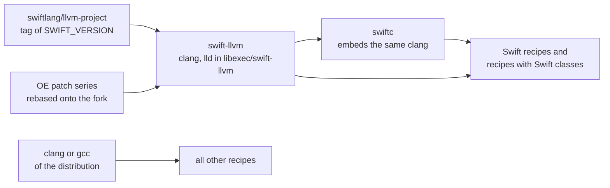
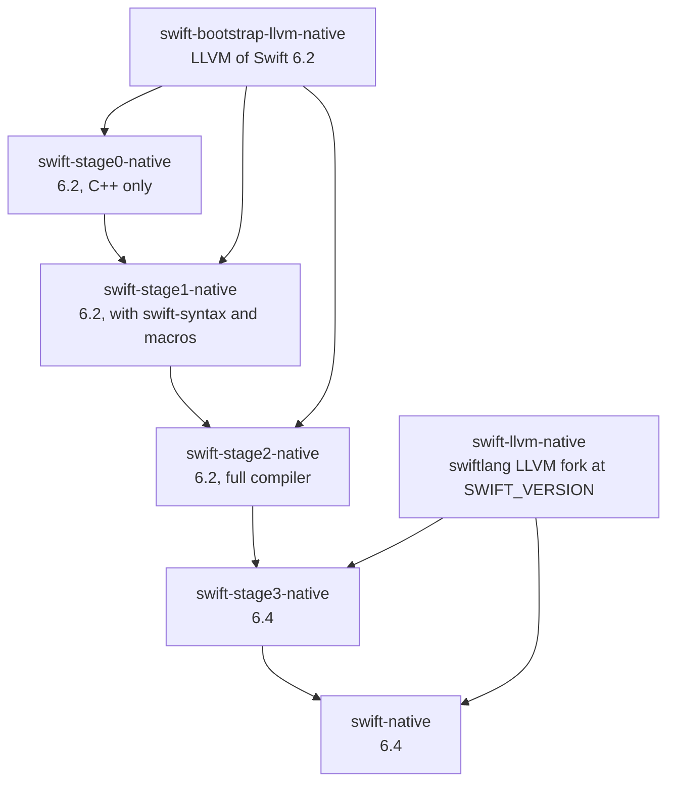
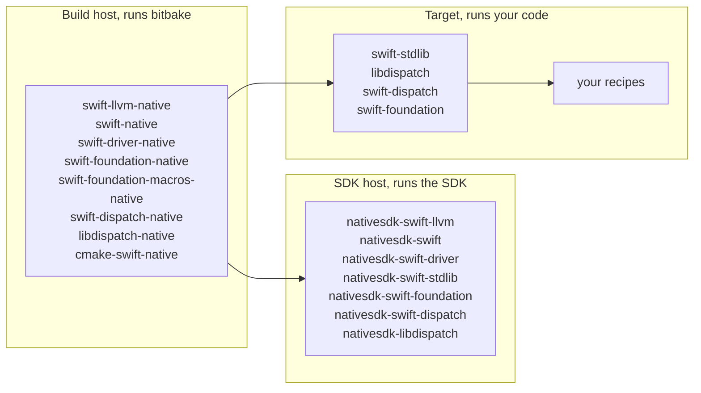

# meta-swift

[](https://github.com/nikolaszimmermann/meta-swift/actions/workflows/build.yml?query=branch%3Amain)
[](https://github.com/nikolaszimmermann/meta-swift/actions/workflows/lint.yml?query=branch%3Amain)

A Yocto/OpenEmbedded layer that builds the [Swift](https://www.swift.org)
toolchain **from source**: the compiler, the runtime for the target and an
SDK. No prebuilt Swift binaries are downloaded at any point. Swift and the C
and C++ code it uses are compiled by one clang, a private build of the LLVM
fork that Swift is developed on. The clang and LLVM of the distribution stay
untouched.

|                 |                                                     |
| --------------- | --------------------------------------------------- |
| Swift           | 6.4.2                                               |
| LLVM            | 21.1, [swiftlang/llvm-project](https://github.com/swiftlang/llvm-project) |
| Yocto releases  | scarthgap, wrynose (built and tested)               |
| Targets         | aarch64, armv7 (hard-float), x86_64                 |
| C library       | glibc, musl (target)                                |
| Build/SDK hosts | x86_64, aarch64                                     |

**Contents:** [Quick start](#quick-start) ·
[How it works](#how-it-works) · [Using Swift](#using-swift) ·
[Support](#support) · [Building](#building) · [CI](#ci) ·
[Development](#development) · [License](#license)

## Quick start

1. Add the layer and its dependencies:
   - [openembedded-core](https://git.openembedded.org/openembedded-core), on
     the branch of your release (`LAYERDEPENDS`). The layer brings its own
     clang, so meta-clang is not needed, but it does no harm either.

   ```sh
   bitbake-layers add-layer /path/to/meta-swift
   ```

2. Enable the toolchain in `local.conf` or a distro configuration. Adding the
   layer alone changes nothing, and all Swift recipes are skipped until then:

   ```
   require conf/distro/include/swift-toolchain.inc
   ```

3. Write a recipe for a CMake project with Swift sources:

   ```
   inherit swift-cmake
   ```

4. Build it, or the smoke test of this layer:

   ```sh
   bitbake swift-cxx-interop-test
   ```

With kas, [`ci/kas/scarthgap.yml`](ci/kas/scarthgap.yml) and
[`ci/kas/wrynose.yml`](ci/kas/wrynose.yml) are complete configurations to
start from. Plan for a long first build, see
[Building](#building).

## How it works

### Private LLVM

Swift embeds clang, the ClangImporter, and only builds against the LLVM fork
of Apple. The C and C++ code that Swift imports or links against has to be
compiled by that very clang, so that both agree on the headers, the clang
resource headers and the language features.

The layer builds the fork at the tag that matches `SWIFT_VERSION`, with the
OE patch series of meta-clang rebased onto it, into a private prefix
(`swift-llvm`, installed to `libexec/swift-llvm`). Only the Swift recipes and
the recipes that inherit the Swift classes use it, through
`TOOLCHAIN = "swiftclang"`. Every other recipe keeps the compiler and the LLVM
of the distribution, down to its task hashes: the CI checks that
([`ci/check-isolation.sh`](ci/check-isolation.sh)).



`swiftclang` keeps the GNU binutils and the GNU runtime of the distribution:
libstdc++ and libgcc. Nothing of the private LLVM ends up in the target
image. Settings that other layers make for `toolchain-clang`, such as those
of meta-clang, do not apply to recipes with the Swift classes. A
`TOOLCHAIN:pn-<recipe>` for such a recipe is an error, as it would mix two
clangs.

### Bootstrap

The compiler is partly written in Swift, and Swift 6.2 is the
[last release that builds from C++ alone](https://forums.swift.org/t/dropping-the-requirement-for-c-only-bootstrapping/87739).
So, like nixpkgs, the layer bootstraps through Swift 6.2 on its own LLVM
fork:



Each arrow points from a recipe to the one it builds or is built into. The
bootstrap LLVM compiles stages 0 to 2 and is embedded in them. The bootstrap
stages are never packaged. Only `swift-native` and what it builds
are.

### Build host, SDK host, target

`swift-native` then builds everything else. Each recipe ends up on one of
three machines:



The SDK also carries the `-dev` packages of the target runtime, so that it
can compile for the target.

## Using Swift

### In recipes

Inherit one class. The others come with it.

| Class              | For                                                                 |
| ------------------ | ------------------------------------------------------------------- |
| `swift-cmake`      | CMake projects with Swift sources. Most recipes want this one.      |
| `swift`            | Other build systems: `swiftc` plus the runtime (`swift-stdlib`, `libdispatch`). |
| `swift-base`       | `swiftc` only, without the runtime.                                 |
| `swift-cmake-tool` | Part of `swift-cmake`: CMake 3.31 of this layer, with policy CMP0157 and linker flags that `swiftc` accepts. |
| `swift-triple`     | Part of `swift-base`: the Swift triple and the tune flags.          |
| `swift-clang`      | Part of `swift-base`: C and C++ with the private clang, in every class. |

`swift-cmake` sets `CMAKE_Swift_COMPILER`, the target triple and the sysroot
in the generated CMake toolchain file. The other classes provide `SWIFTC`,
`SWIFT_TARGET` and `SWIFTFLAGS` for recipes that call the compiler
themselves.

[`swift-cxx-interop-test`](recipes-test/swift-cxx-interop-test) is a
complete example: a Swift executable, a Swift library that uses C++, and a
C++ executable that calls into Swift through the generated header.

### In the SDK

With the toolchain enabled, `bitbake -c populate_sdk <image>` produces an SDK
that contains `swiftc`, swift-driver, the private swiftlang clang, and the
development files of the Swift runtime, Foundation and Dispatch for the
target. Its environment script sets `SWIFTC`, `SWIFT_TARGET` and `SWIFTFLAGS`
for the Swift compiler, and `SWIFT_CLANGCC`, `SWIFT_CLANGCXX` and
`SWIFT_CLANGCPP` for C and C++ code that Swift uses. `CC` and `CXX` stay the
compilers of the distribution. Set `SWIFTSDK = "0"` to leave Swift out of the
SDK.

## Support

| Release   | Status           |
| --------- | ---------------- |
| scarthgap | built and tested |
| wrynose   | built and tested |

Both are LTS releases. The layer does not support the short-lived stable
releases in between.

| Targets                             | Build and SDK hosts |
| ----------------------------------- | ------------------- |
| aarch64, armv7 (hard-float), x86_64 | x86_64, aarch64     |

The target can use musl (`TCLIBC = "musl"`) instead of glibc. The CI builds
and tests that on aarch64 with wrynose, like the CI of meta-webkit. Swift
itself only builds musl as its fully static Linux SDK. Here the runtime is
built shared, for the triple of the distribution, in `lib/swift/musl`, where
the compiler looks for it (`SWIFT_PLATFORM`, patch 0008 of swift-stdlib).
The build and SDK hosts stay on glibc.

### Limitations

- lldb cannot debug Swift code. `swift-llvm` builds no lldb, and there is no
  Swift-aware lldb recipe.

## Building

### Resources

A cold build compiles LLVM several times (swift-llvm for the build host and
the SDK host, the Swift bootstrap LLVM) plus six Swift compiler builds (five
for the build host, one for the SDK host), and takes many hours. Images that also use the clang of the distribution build
that one as well. Several LLVM builds run at once, at up to 2 GB per C++ compiler
process.

> [!WARNING]
> With the bitbake defaults, a 40-CPU machine with 64 GB of RAM ran out of
> memory. Limit `BB_NUMBER_THREADS` and `PARALLEL_MAKE` as
> [`ci/kas/common.yml`](ci/kas/common.yml) does, and share `DL_DIR`
> and `SSTATE_DIR` between builds.

### Reproducing a CI build

```sh
KAS_WORK_DIR=~/meta-swift-work DL_DIR=... SSTATE_DIR=... \
    kas-container build ci/kas/scarthgap-qemuarm64.yml
```

`KAS_WORK_DIR` must be outside this checkout, as kas clones the other layers
there.

## CI

Two GitHub Actions workflows run on pushes to `main` and on pull requests
against it. The badges at the top show their state on `main`.

| Workflow                                         | Runs on                     | Does                                              |
| ------------------------------------------------ | --------------------------- | ------------------------------------------------- |
| [build](.github/workflows/build.yml)             | self-hosted, rootless podman | builds `swift-cxx-interop-test`, an image and an SDK for each kas configuration in `ci/kas/`, compiles a program with the SDK and runs the tests in QEMU |
| [lint](.github/workflows/lint.yml)               | GitHub-hosted               | runs oelint-adv, fails on any finding             |

### build

There is one job per kas configuration: scarthgap and wrynose, each with
qemuarm64, qemuarm and qemux86-64, i.e. aarch64, ARMv7 hard-float and
x86_64, plus wrynose-qemuarm64-musl with musl instead of glibc. `ci/kas/common.yml` holds what the releases share. The build is far
too large for GitHub-hosted runners, so it runs on a self-hosted runner
labelled `meta-swift`. Each job:

1. checks that the Swift toolchain leaves the task hashes of recipes without
   Swift unchanged ([`ci/check-isolation.sh`](ci/check-isolation.sh)),
2. fetches all sources first, with retries,
3. builds `swift-cxx-interop-test`, `core-image-minimal` and its SDK,
4. installs the SDK and compiles
   [a Swift program](ci/sdk-test/hello.swift) with it, using Dispatch and
   Foundation, and [a C++ program](ci/sdk-test/hello.cpp) with its private
   clang (`SWIFT_CLANGCXX`) ([`ci/test-sdk.sh`](ci/test-sdk.sh)),
5. boots the image in QEMU with `testimage` and runs the ptest of
   `swift-cxx-interop-test` and the program from the SDK
   ([`swift_sdk.py`](lib/oeqa/runtime/cases/swift_sdk.py)) on it,
6. cleans the work directories that `rm_work` leaves, those of the SDK host
   recipes and of the QEMU, with `bitbake -c clean`, so that the build
   directory stays small without building anything. Of the image it only
   removes the rootfs, the SDK staging directory and the pseudo database, so
   that the next run does not have to create the image and its SDK again
   ([`ci/trim-build-dir.sh`](ci/trim-build-dir.sh)),
7. fails when bitbake reports a non-deterministic task hash, since that
   breaks sstate reuse, even if every task succeeded,
8. on failure, uploads the logs of failed tasks and the QEMU test logs as
   the `logs-<config>` artifact of the run, kept for 14 days.

Downloads, sstate and the build directory persist in `~/meta-swift-ci`, or
in the directory set by the repository variable `META_SWIFT_CI_CACHE`. A
newer push to a pull request cancels the build of the old commit. On
`main`, it queues behind the running build. A cancelled build can leave a
task half done, so the next job after it rebuilds the temporary build
directory (`TMPDIR`) from sstate. Pull requests from forks of external
contributors only run once approved.

Any runner with the `meta-swift` label can take a job. The build parallelism
in `ci/kas/common.yml` fits a runner with 40 CPUs and 64 GB of RAM. A
smaller runner lowers it in the `.env` file in its installation directory:

```sh
META_SWIFT_BB_NUMBER_THREADS=4
META_SWIFT_PARALLEL_MAKE=-j8
```

### lint

oelint-adv is pinned to the version in the workflow. Suppressed rules and
the reasons are in `.oelint.cfg`. To suppress a single finding, put a
`# nooelint: <rule>` comment on the line before it. Run it locally from the
top of the layer, where it reads `.oelint.cfg`:

```sh
pipx install oelint-adv==9.6.1
find . -path ./.git -prune -o -type f \( -name '*.bb' -o -name '*.bbappend' \
    -o -name '*.bbclass' \) -print0 | xargs -0 oelint-adv
```

## Development

### Patches to upstream

The patches of this layer that are not OE specific, all still
`Upstream-Status: Pending`. The rest of the LLVM patch series of `swift-llvm`
comes from meta-clang, rebased onto the fork.

| Project | Patch | What it does |
| ------- | ----- | ------------ |
| llvm-project | [0100](recipes-devtools/swift/swift-llvm/0100-lldb-Only-install-the-copied-clang-resource-director.patch) | lldb only installs `lib/lldb/clang` with Swift support, which fails the install without it. |
| llvm-project | [0101](recipes-devtools/swift/swift-llvm/0101-clang-Prefer-sysroot-usr-for-GCC-in-usrmerge-sysroots.patch) | clang finds GCC under `<sysroot>/usr` in usrmerge sysroots, so the libstdc++ module map of Swift covers the headers clang reads. |
| llvm-project | [0102](recipes-devtools/swift/swift-llvm/0102-lldb-Fix-the-VirtualDataExtractor-build-for-32-bit-t.patch) | Fixes the lldb build for 32-bit targets. |
| swift | [0001](recipes-devtools/swift/files/0001-cmake-Support-standalone-builds-against-an-installed.patch) | Builds the compiler against an installed LLVM and clang instead of an LLVM build tree. Also in [bootstrap-6.2](recipes-devtools/swift/files/bootstrap-6.2/0001-cmake-Support-standalone-builds-against-an-installed.patch). |
| swift | [0002](recipes-devtools/swift/files/0002-SwiftConfigureSDK-Allow-overriding-the-Linux-target-.patch) | Lets the build pick the Linux target triple, e.g. `aarch64-poky-linux`. |
| swift | [0003](recipes-devtools/swift/files/0003-sil-missing-headers.patch) | Includes the clang headers that complete the iterators of `clang::DeclContext`, adapted from nixpkgs. |
| swift | [0004](recipes-devtools/swift/files/0004-cmake-Do-not-add-system-include-directories-of-an-in.patch) | Keeps the system include directory of an installed LLVM out of the Swift `-I` flags, where it hides the clang `<tgmath.h>`. |
| swift | [0005](recipes-devtools/swift/files/0005-SwiftCompilerSources-Use-SwiftShims-from-SWIFT_PATH_.patch) | Takes SwiftShims only from `SWIFT_PATH_TO_SWIFT_SDK` when building against the runtime of another SDK. |
| swift | [0006](recipes-devtools/swift/files/0006-ClangImporter-Do-not-track-files-injected-into-the-C.patch) | Does not record the module maps injected into the Clang VFS as dependencies, which broke rebuilding modules such as Cxx. |
| swift | [0007](recipes-devtools/swift/files/0007-runtime-Fix-the-crash-handler-build-for-32-bit-ARM-L.patch) | Fixes the crash handler build for 32-bit ARM Linux. |
| swift | [0008](recipes-devtools/swift/files/0008-cmake-Support-a-shared-musl-runtime-for-Musl-distrib.patch) | Builds a shared runtime in `lib/swift/musl` for a distribution on musl, with its own triple and libstdc++, next to the fully static Linux SDK. |
| swift-corelibs-libdispatch | [0001](recipes-devtools/swift/libdispatch/0001-benchmark-Make-the-integer-to-floating-point-convers.patch) | Makes integer to floating point conversions in the benchmark explicit, which fixes the `-Werror` build on 32-bit targets. |
| swift-driver | [valid-module-names](recipes-devtools/swift/swift-driver/swift-driver-valid-module-names.patch) | Gives the executables valid Swift module names, as swift-driver rejects names like `swift-help`. |

All projects are under [github.com/swiftlang](https://github.com/swiftlang).

### Contributing

Send pull requests against `main`. Every patch needs an `Upstream-Status`
tag, and the lint job must pass.

## License

The metadata of this layer is under the MIT license, see
[`COPYING.MIT`](COPYING.MIT). The software the recipes build carries its own
licenses, given in `LICENSE` of each recipe.
