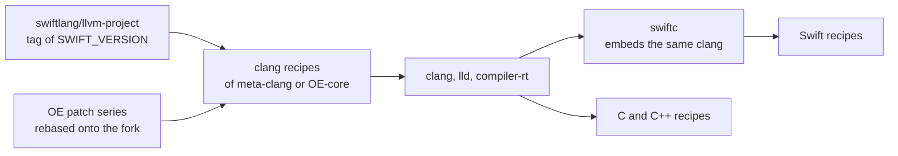
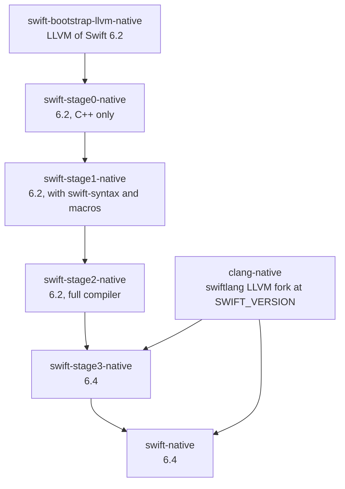
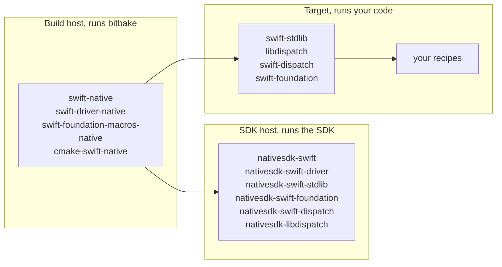

# meta-swift

[](https://github.com/nikolaszimmermann/meta-swift/actions/workflows/build.yml?query=branch%3Amain)
[](https://github.com/nikolaszimmermann/meta-swift/actions/workflows/lint.yml?query=branch%3Amain)

A Yocto/OpenEmbedded layer that builds the [Swift](https://www.swift.org)
toolchain **from source**: the compiler, the runtime for the target and an
SDK. No prebuilt Swift binaries are downloaded at any point. C, C++ and Swift
are all compiled by one clang, from the LLVM fork that Swift is developed on.

|                 |                                                     |
| --------------- | --------------------------------------------------- |
| Swift           | 6.4.2                                               |
| LLVM            | 21.1, [swiftlang/llvm-project](https://github.com/swiftlang/llvm-project) |
| Yocto releases  | scarthgap (built and tested), wrynose (in progress) |
| Targets         | aarch64, armv7 (hard-float)                         |
| Build/SDK hosts | x86_64, aarch64                                     |

**Contents:** [Quick start](#quick-start) ·
[How it works](#how-it-works) · [Using Swift](#using-swift) ·
[Support](#support) · [Building](#building) · [CI](#ci) ·
[Development](#development) · [License](#license)

## Quick start

1. Add the layer and its dependencies:
   - [openembedded-core](https://git.openembedded.org/openembedded-core), on
     the branch of your release (`LAYERDEPENDS`).
   - [meta-clang](https://github.com/kraj/meta-clang) on scarthgap
     (`LAYERRECOMMENDS`). In wrynose, OE-core carries the clang recipes and
     meta-clang is not needed.

   ```sh
   bitbake-layers add-layer /path/to/meta-swift
   ```

2. Enable the toolchain in `local.conf` or a distro configuration. Adding the
   layer alone changes nothing, and all Swift recipes are skipped until then:

   ```
   require conf/distro/include/swift-toolchain.inc
   ```

3. Write a recipe for a CMake project with Swift sources:

   ```
   inherit swift-cmake
   ```

4. Build it, or the smoke test of this layer:

   ```sh
   bitbake swift-cxx-interop-test
   ```

With kas, [`ci/kas/scarthgap.yml`](ci/kas/scarthgap.yml) is a complete
configuration to start from. Plan for a long first build, see
[Building](#building).

## How it works

### One LLVM

Swift embeds clang, the ClangImporter, and only builds against the LLVM fork
of Apple. Instead of a second LLVM next to the one of the distribution, the
layer makes that fork the clang/LLVM of the whole build. The meta-clang or
OE-core recipes keep doing all the work, but fetch the fork at the tag that
matches `SWIFT_VERSION`, with the OE patch series rebased onto it.



C, C++ and Swift are then compiled by the very same clang, linked by the same
lld, and agree on the clang resource headers. This matters most for C++
interoperability, where Swift imports the same headers that the C++ code
of other recipes was compiled with.

The fork follows LLVM with some delay. Swift 6.4.2 is LLVM 21.1, which is
newer than meta-clang for scarthgap (20.1) but older than wrynose (22.1) and
master. **Enabling the layer there downgrades the LLVM used by every
clang-built recipe.**

### Bootstrap

The compiler is partly written in Swift, and Swift 6.2 is the
[last release that builds from C++ alone](https://forums.swift.org/t/dropping-the-requirement-for-c-only-bootstrapping/87739).
So, like nixpkgs, the layer bootstraps through Swift 6.2 on its own LLVM
fork:



Each arrow points from a recipe to the one it builds or is built into. The
bootstrap stages are never packaged. Only `swift-native` and what it builds
are.

### Build host, SDK host, target

`swift-native` then builds everything else. Each recipe ends up on one of
three machines:



The SDK also carries the `-dev` packages of the target runtime, so that it
can compile for the target.

## Using Swift

### In recipes

Inherit one class. The others come with it.

| Class              | For                                                                 |
| ------------------ | ------------------------------------------------------------------- |
| `swift-cmake`      | CMake projects with Swift sources. Most recipes want this one.      |
| `swift`            | Other build systems: `swiftc` plus the runtime (`swift-stdlib`, `libdispatch`). |
| `swift-base`       | `swiftc` only, without the runtime.                                 |
| `swift-cmake-tool` | Part of `swift-cmake`: CMake 3.31 of this layer, with policy CMP0157 and linker flags that `swiftc` accepts. |
| `swift-triple`     | Part of `swift-base`: the Swift triple and the tune flags.          |

`swift-cmake` sets `CMAKE_Swift_COMPILER`, the target triple and the sysroot
in the generated CMake toolchain file. The other classes provide `SWIFTC`,
`SWIFT_TARGET` and `SWIFTFLAGS` for recipes that call the compiler
themselves.

[`swift-cxx-interop-test`](recipes-test/swift-cxx-interop-test) is a
complete example: a Swift executable, a Swift library that uses C++, and a
C++ executable that calls into Swift through the generated header.

### In the SDK

With the toolchain enabled, `bitbake -c populate_sdk <image>` produces an SDK
that contains `swiftc`, swift-driver, the swiftlang clang, and the development
files of the Swift runtime, Foundation and Dispatch for the target. Set
`SWIFTSDK = "0"` to leave Swift out of the SDK.

## Support

| Release   | LLVM recipes from       | Status           |
| --------- | ----------------------- | ---------------- |
| scarthgap | meta-clang (any branch) | built and tested |
| wrynose   | OE-core                 | in progress      |

Both are LTS releases. The layer does not support the short-lived stable
releases in between.

| Targets                     | Build and SDK hosts |
| --------------------------- | ------------------- |
| aarch64, armv7 (hard-float) | x86_64, aarch64     |

### Limitations

- lldb cannot debug Swift code. The lldb of the swiftlang fork is built with
  `LLDB_ENABLE_SWIFT_SUPPORT=OFF`, as Swift support needs the build tree of
  the Swift compiler, and there is no Swift-aware lldb recipe.

## Building

### Resources

A cold build compiles LLVM several times (clang-native, the Swift bootstrap
LLVM, the cross clang) plus five Swift compiler builds, and takes many
hours. Several LLVM builds run at once, at up to 2 GB per C++ compiler
process.

> [!WARNING]
> With the bitbake defaults, a 40-CPU machine with 64 GB of RAM ran out of
> memory. Limit `BB_NUMBER_THREADS` and `PARALLEL_MAKE` as
> [`ci/kas/scarthgap.yml`](ci/kas/scarthgap.yml) does, and share `DL_DIR`
> and `SSTATE_DIR` between builds.

### Reproducing a CI build

```sh
KAS_WORK_DIR=~/meta-swift-work DL_DIR=... SSTATE_DIR=... \
    kas-container build ci/kas/scarthgap-qemuarm64.yml
```

`KAS_WORK_DIR` must be outside this checkout, as kas clones poky and
meta-clang there.

## CI

Two GitHub Actions workflows run on pushes to `main` and on pull requests
against it. The badges at the top show their state on `main`.

| Workflow                                         | Runs on                     | Does                                              |
| ------------------------------------------------ | --------------------------- | ------------------------------------------------- |
| [build](.github/workflows/build.yml)             | self-hosted, rootless podman | builds `swift-cxx-interop-test` for each kas configuration in `ci/kas/` |
| [lint](.github/workflows/lint.yml)               | GitHub-hosted               | runs oelint-adv, fails on any finding             |

### build

There is one job per kas configuration: scarthgap with qemuarm64 and
qemuarm, i.e. aarch64 and ARMv7 hard-float. The build is far too large for
GitHub-hosted runners, so it runs on a self-hosted runner labelled
`meta-swift`. Each job:

1. fetches all sources first, with retries,
2. builds,
3. fails when bitbake reports a non-deterministic task hash, since that
   breaks sstate reuse, even if every task succeeded,
4. on failure, uploads the logs of failed tasks as the `logs-<config>`
   artifact of the run, kept for 14 days.

Downloads, sstate and the build directory persist in `~/meta-swift-ci`, or
in the directory set by the repository variable `META_SWIFT_CI_CACHE`. A
newer push queues behind a running build of the same branch rather than
cancelling it. Pull requests from forks of external contributors only run
once approved.

### lint

oelint-adv is pinned to the version in the workflow. Suppressed rules and
the reasons are in `.oelint.cfg`. To suppress a single finding, put a
`# nooelint: <rule>` comment on the line before it. Run it locally from the
top of the layer, where it reads `.oelint.cfg`:

```sh
pipx install oelint-adv==9.6.1
find . -path ./.git -prune -o -type f \( -name '*.bb' -o -name '*.bbappend' \
    -o -name '*.bbclass' \) -print0 | xargs -0 oelint-adv
```

## Development

### Patches to upstream

The patches of this layer that are not OE specific, all still
`Upstream-Status: Pending`. The rest of the LLVM patch series comes from
meta-clang, rebased onto the fork.

| Project | Patch | What it does |
| ------- | ----- | ------------ |
| llvm-project | [0100](llvm-integration/meta-clang/clang/files-scarthgap/0100-lldb-Only-install-the-copied-clang-resource-director.patch) | lldb only installs `lib/lldb/clang` with Swift support, which fails the install without it. |
| llvm-project | [0101](llvm-integration/meta-clang/clang/files-scarthgap/0101-clang-Prefer-sysroot-usr-for-GCC-in-usrmerge-sysroots.patch) | clang finds GCC under `<sysroot>/usr` in usrmerge sysroots, so the libstdc++ module map of Swift covers the headers clang reads. |
| llvm-project | [0102](llvm-integration/meta-clang/clang/files-scarthgap/0102-lldb-Fix-the-VirtualDataExtractor-build-for-32-bit-t.patch) | Fixes the lldb build for 32-bit targets. |
| swift | [0001](recipes-devtools/swift/files/0001-cmake-Support-standalone-builds-against-an-installed.patch) | Builds the compiler against an installed LLVM and clang instead of an LLVM build tree. Also in [bootstrap-6.2](recipes-devtools/swift/files/bootstrap-6.2/0001-cmake-Support-standalone-builds-against-an-installed.patch). |
| swift | [0002](recipes-devtools/swift/files/0002-SwiftConfigureSDK-Allow-overriding-the-Linux-target-.patch) | Lets the build pick the Linux target triple, e.g. `aarch64-poky-linux`. |
| swift | [0003](recipes-devtools/swift/files/0003-sil-missing-headers.patch) | Includes the clang headers that complete the iterators of `clang::DeclContext`, adapted from nixpkgs. |
| swift | [0004](recipes-devtools/swift/files/0004-cmake-Do-not-add-system-include-directories-of-an-in.patch) | Keeps the system include directory of an installed LLVM out of the Swift `-I` flags, where it hides the clang `<tgmath.h>`. |
| swift | [0005](recipes-devtools/swift/files/0005-SwiftCompilerSources-Use-SwiftShims-from-SWIFT_PATH_.patch) | Takes SwiftShims only from `SWIFT_PATH_TO_SWIFT_SDK` when building against the runtime of another SDK. |
| swift | [0006](recipes-devtools/swift/files/0006-ClangImporter-Do-not-track-files-injected-into-the-C.patch) | Does not record the module maps injected into the Clang VFS as dependencies, which broke rebuilding modules such as Cxx. |
| swift | [0007](recipes-devtools/swift/files/0007-runtime-Fix-the-crash-handler-build-for-32-bit-ARM-L.patch) | Fixes the crash handler build for 32-bit ARM Linux. |
| swift-corelibs-libdispatch | [0001](recipes-devtools/swift/libdispatch/0001-benchmark-Make-the-integer-to-floating-point-convers.patch) | Makes integer to floating point conversions in the benchmark explicit, which fixes the `-Werror` build on 32-bit targets. |
| swift-driver | [valid-module-names](recipes-devtools/swift/swift-driver/swift-driver-valid-module-names.patch) | Gives the executables valid Swift module names, as swift-driver rejects names like `swift-help`. |

All projects are under [github.com/swiftlang](https://github.com/swiftlang).

### TODO

- [ ] wrynose: add the bbappends for the OE-core clang and llvm recipes in
  `llvm-integration/oe-core/`, which `conf/layer.conf` already points to but
  which do not exist yet.
- [ ] CI on wrynose: build the same release as meta-webkit, once wrynose
  builds.
- [ ] CI: build an SDK with `populate_sdk`, as the CI target does not depend
  on the SDK host recipes (`nativesdk-swift` and the rest), and run the
  ptest of `swift-cxx-interop-test` in QEMU.
- [ ] musl: build and test qemuarm64 with `TCLIBC = "musl"`, as meta-webkit
  does.
- [ ] riscv64: build and test it, and add it to the CI.
- [ ] Send the patches listed under
  [Patches to upstream](#patches-to-upstream) upstream.

### Contributing

Send pull requests against `main`. Every patch needs an `Upstream-Status`
tag, and the lint job must pass.

## License

The metadata of this layer is under the MIT license, see
[`COPYING.MIT`](COPYING.MIT). The software the recipes build carries its own
licenses, given in `LICENSE` of each recipe.
