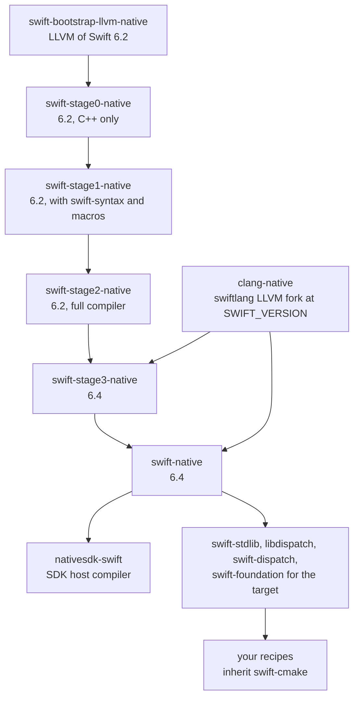

# meta-swift

Yocto/OpenEmbedded layer that builds the [Swift](https://www.swift.org)
toolchain **from source**, on top of the clang/LLVM recipes of meta-clang
(scarthgap, walnascar) or OE-core (whinlatter and later).

No prebuilt Swift binaries are downloaded at any point. Since Swift 6.4 the
compiler can no longer be built from C++ alone, so, like nixpkgs, the layer
bootstraps through Swift 6.2 on its own LLVM fork:

Each arrow points from a recipe to the one it builds or is built into. Only
`swift-native`, `nativesdk-swift` and the target runtime are packaged. The
bootstrap stages are not.

## Dependencies

- [openembedded-core](https://git.openembedded.org/openembedded-core)
  (`LAYERDEPENDS`), on the branch of the release you build.
- [meta-clang](https://github.com/kraj/meta-clang) for scarthgap and
  walnascar (`LAYERRECOMMENDS`). From whinlatter on, OE-core carries the
  clang recipes and meta-clang is not needed.

Add the layer with

    bitbake-layers add-layer /path/to/meta-swift

or use `ci/kas/scarthgap.yml` as a starting point for a kas configuration.

## One LLVM

Swift embeds clang (the ClangImporter) and only builds against the LLVM fork of
Apple, [swiftlang/llvm-project](https://github.com/swiftlang/llvm-project).
This layer therefore makes that fork the clang/LLVM of the whole build: the
meta-clang/OE-core recipes keep doing all the work, but fetch the fork at the
tag matching `SWIFT_VERSION`, with the OE patch series rebased onto it. C, C++
and Swift are then compiled by the very same clang, linked by the same lld,
and agree on the clang resource headers.

This is opt-in. Adding the layer alone changes nothing. Enable it with

    require conf/distro/include/swift-toolchain.inc

in `local.conf` or a distro configuration. Without it, all Swift recipes are
skipped.

Note that the fork follows LLVM with some delay. Swift 6.4.2 is LLVM 21.1,
which is newer than meta-clang for scarthgap (20.1) and matches whinlatter, but
older than wrynose (22.1) and master. Enabling the layer there downgrades the
LLVM used by every clang-built recipe.

## Supported

| Release            | LLVM recipes from       | Status           |
| ------------------ | ----------------------- | ---------------- |
| scarthgap          | meta-clang (any branch) | built and tested |
| walnascar          | meta-clang              | parse only       |
| whinlatter, wrynose| OE-core                 | in progress      |

Targets: aarch64, armv7 (hard-float).
Build/SDK hosts: x86_64, aarch64.

## Using Swift in recipes

    inherit swift-cmake

sets up `CMAKE_Swift_COMPILER`, the target triple and the sysroot in the
generated CMake toolchain file, and depends on the Swift runtime.

## SDK

With the toolchain enabled, `bitbake -c populate_sdk <image>` produces an SDK
that contains `swiftc`, swift-driver, the swiftlang clang, and the development
files of the Swift runtime, Foundation and Dispatch for the target. Set
`SWIFTSDK = "0"` to leave Swift out of the SDK.

## Limitations

- lldb cannot debug Swift code. The lldb of the swiftlang fork is built with
  `LLDB_ENABLE_SWIFT_SUPPORT=OFF`, as Swift support needs the build
  tree of the Swift compiler, and there is no Swift-aware lldb recipe.

## Build resources

A cold build compiles LLVM several times (clang-native, the Swift bootstrap
LLVM, the cross clang) plus five Swift compiler builds, and takes many
hours. Several LLVM builds run at once, at up to 2 GB per C++ compiler
process: with the bitbake defaults, a 40-CPU machine with 64 GB of RAM ran out
of memory. Limit `BB_NUMBER_THREADS` and `PARALLEL_MAKE` as
`ci/kas/scarthgap.yml` does, and share `DL_DIR` and `SSTATE_DIR` between
builds.

## CI

Two GitHub Actions workflows run on pushes to `main` and on pull requests
against it. The badges at the top show their state on `main`.

### build

`.github/workflows/build.yml` builds `swift-cxx-interop-test` for the kas
configurations in `ci/kas/` (scarthgap with qemuarm64 and qemuarm, i.e.
aarch64 and ARMv7 hard-float), one job per configuration. The build is far
too large for GitHub-hosted runners, so it runs on a self-hosted runner
labelled `meta-swift` with rootless podman. Downloads, sstate and the build
directory persist in `~/meta-swift-ci`, or in the directory set by the
repository variable `META_SWIFT_CI_CACHE`. Pull requests from forks of
external contributors only run once approved.

Each job fetches all sources first (with retries), then builds. It also fails
when bitbake reports a non-deterministic task hash, since that breaks sstate
reuse, even if every task succeeded. The logs of failed tasks are uploaded as
the `logs-<config>` artifact of the run and kept for 14 days. A newer push
queues behind a running build of the same branch rather than cancelling it.

### lint

`.github/workflows/lint.yml` runs oelint-adv (pinned to the version in the
workflow) on GitHub-hosted runners and fails on any finding. Suppressed rules
and the reasons are in `.oelint.cfg`. To suppress a single finding,
put a `# nooelint: <rule>` comment on the line before it. Run it locally
from the top of the layer, where it reads `.oelint.cfg`:

    pipx install oelint-adv==9.6.1
    find . -path ./.git -prune -o -type f \( -name '*.bb' -o -name '*.bbappend' \
        -o -name '*.bbclass' \) -print0 | xargs -0 oelint-adv

### Reproducing a CI build

To reproduce a CI build locally:

    KAS_WORK_DIR=~/meta-swift-work DL_DIR=... SSTATE_DIR=... \
        kas-container build ci/kas/scarthgap-qemuarm64.yml

`KAS_WORK_DIR` must be outside this checkout, as kas clones poky and
meta-clang there.

## Patches to upstream

The patches of this layer that are not OE specific, all still
`Upstream-Status: Pending`. The rest of the LLVM patch series comes from
meta-clang, rebased onto the fork.

swiftlang/llvm-project:

- [0100](llvm-integration/meta-clang/clang/files-scarthgap/0100-lldb-Only-install-the-copied-clang-resource-director.patch):
  lldb only installs `lib/lldb/clang` with Swift support, which fails the
  install without it.
- [0101](llvm-integration/meta-clang/clang/files-scarthgap/0101-clang-Prefer-sysroot-usr-for-GCC-in-usrmerge-sysroots.patch):
  clang finds GCC under `<sysroot>/usr` in usrmerge sysroots, so the
  libstdc++ module map of Swift covers the headers clang reads.
- [0102](llvm-integration/meta-clang/clang/files-scarthgap/0102-lldb-Fix-the-VirtualDataExtractor-build-for-32-bit-t.patch):
  fixes the lldb build for 32-bit targets.

swiftlang/swift:

- [0001](recipes-devtools/swift/files/0001-cmake-Support-standalone-builds-against-an-installed.patch):
  builds the compiler against an installed LLVM and clang instead of an
  LLVM build tree. The same patch for the 6.2 bootstrap is in
  [bootstrap-6.2](recipes-devtools/swift/files/bootstrap-6.2/0001-cmake-Support-standalone-builds-against-an-installed.patch).
- [0002](recipes-devtools/swift/files/0002-SwiftConfigureSDK-Allow-overriding-the-Linux-target-.patch):
  lets the build pick the Linux target triple, e.g. `aarch64-poky-linux`.
- [0003](recipes-devtools/swift/files/0003-sil-missing-headers.patch): includes the clang headers that
  complete the iterators of `clang::DeclContext`, adapted from nixpkgs.
- [0004](recipes-devtools/swift/files/0004-cmake-Do-not-add-system-include-directories-of-an-in.patch):
  keeps the system include directory of an installed LLVM out of the Swift
  `-I` flags, where it hides the clang `<tgmath.h>`.
- [0005](recipes-devtools/swift/files/0005-SwiftCompilerSources-Use-SwiftShims-from-SWIFT_PATH_.patch):
  takes SwiftShims only from `SWIFT_PATH_TO_SWIFT_SDK` when building against
  the runtime of another SDK.
- [0006](recipes-devtools/swift/files/0006-ClangImporter-Do-not-track-files-injected-into-the-C.patch):
  does not record the module maps injected into the Clang VFS as
  dependencies, which broke rebuilding modules such as Cxx.
- [0007](recipes-devtools/swift/files/0007-runtime-Fix-the-crash-handler-build-for-32-bit-ARM-L.patch):
  fixes the crash handler build for 32-bit ARM Linux.

swiftlang/swift-corelibs-libdispatch:

- [0001](recipes-devtools/swift/libdispatch/0001-benchmark-Make-the-integer-to-floating-point-convers.patch):
  makes integer to floating point conversions in the benchmark explicit,
  which fixes the `-Werror` build on 32-bit targets.

swiftlang/swift-driver:

- [valid-module-names](recipes-devtools/swift/swift-driver/swift-driver-valid-module-names.patch):
  gives the executables valid Swift module names, as swift-driver rejects
  names like `swift-help`.

## TODO

- whinlatter, wrynose: add the bbappends for the OE-core clang and llvm
  recipes in `llvm-integration/oe-core/`, which `conf/layer.conf` already
  points to but which do not exist yet.
- walnascar: build and test it. It only parses so far, and the rebased LLVM
  patch series exists for scarthgap only (`files-scarthgap`).
- riscv64: build and test it, and add it to the CI.
- CI on wrynose: build the same release as meta-webkit, once wrynose
  builds.
- musl: build and test qemuarm64 with `TCLIBC = "musl"`, as meta-webkit does.
- CI: build an SDK with `populate_sdk`, as the CI target does not depend on
  the SDK host recipes (`nativesdk-swift` and the rest), and run the ptest
  of `swift-cxx-interop-test` in QEMU.
- Send the patches listed under "Patches to upstream" upstream.

## Contributing

Send pull requests against `main`. Every patch needs an `Upstream-Status`
tag, and the lint job must pass.

## License

The metadata of this layer is under the MIT license, see `COPYING.MIT`. The
software the recipes build carries its own licenses, given in `LICENSE` of
each recipe.
